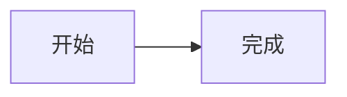

# 中文离线导出样本

导出包含当前的**未保存修改**，不会覆盖源 Markdown。

- 标题、列表、中文与 Emoji 🙂
- [外部链接](https://example.com)

| 内容 | 结果 |
| --- | --- |
| 表格 | 离线可读 |

```javascript
const greeting = "你好，世界";
console.log(greeting);
```




$$
x^2 + y^2 = z^2
$$
